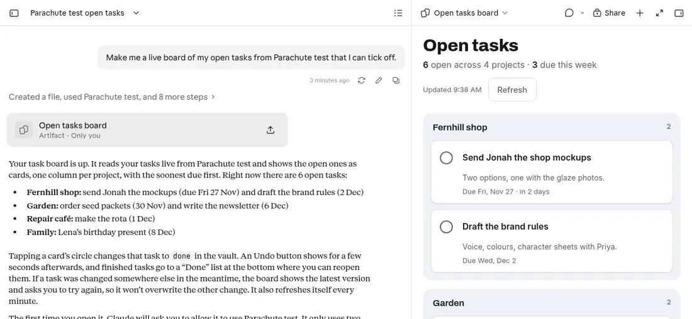

*On a 0.8 server (Parachute Cloud today):* the page calls `query-notes` and `update-note`; a record's `body` and `fields` are `content` and `metadata`, types go in `tags`, and `include_body` is `include_content`. Change the template's names to match. A 0.8 refusal carries no `structuredContent`; the template then knows a conflict by its word and shows a plain line for the rest.

**Tested in claude.ai.** Asked in plain words, Claude built a task board, a reading tracker, a people list and a journal page over a test vault, each reading and writing it, and Duet did the same. The template below was published there as it is and exercised. Those runs used Parachute's next release on a test server; on Parachute Cloud (0.8) pages aren't tried in claude.ai yet.



A Claude artifact can call your connectors every time someone opens it. Over Parachute that makes a small live page: your open tasks, a reading list, a people directory. It reads and writes your vault on the viewer's own connection. The page never sees a key, and no model runs when it opens.

You need Parachute [connected on claude.ai](/docs/use/connect-your-ai/) (**+ › Plugins**): a page calls your claude.ai connectors, not a server you added only to Claude Code. You also need a Pro, Max, Ultra, Team or Enterprise plan, on the web or the desktop app. Each viewer sees their own vault, through their own connection; people share a list only when they're connected to the same vault.

## Ask for one

Ask in a claude.ai chat. Plain words are enough ("make me a live board of my open tasks in Parachute that I can tick off"); this asks for more:

> Using my Parachute connector, make me a live page (an artifact) of my open tasks, earliest due first, with a way to tick one done and change its date. Look at the vault first so it uses my own types and fields.

Claude looks at your vault's types, writes the page, and publishes it once you say yes. The page declares the tools it calls: `query-records` to read, `update-record` to change, and `create-record` if it adds records. Ask for changes in plain words ("group them by project", "show the notes").

You don't need to explain Parachute to Claude. The connector tells it how to build a page that works:

- read with `watchTool` on `query-records`, filtered by `type`, `path_prefix` or `fields`;
- the reply is one record, a list, or `{records, next_cursor}` when it pages; a record's name is the last part of its `path`;
- read again every 30 seconds while the page is on screen, show when it last read, and add a Refresh;
- write only when someone clicks, with `if_updated_at` set to the record's `updatedAt`, then refresh the reads;
- if the record changed elsewhere in the meantime, read it again and show it; never overwrite.

## The template

A tested page: your vault's tasks, earliest due first; tick one done, change its date, edit its note. Its top line says how old the list is ("4 open · Updated just now · Refresh"). Hand it to Claude ("start from this page and make it a reading tracker") or publish it as it is. It expects records of type `task` with `status`, `due` and `project` fields, where a finished task's status is `done`; change `QUERY`, `OPEN` and the fields it shows to fit your types.

It declares two tools for the connector named `Parachute` (the name you gave it in Claude):

```json
{ "mcp": { "servers": [ { "server": "Parachute", "tools": ["query-records", "update-record"] } ] } }
```

```html
<!doctype html>
<html lang="en">
<head>
<meta charset="utf-8">
<meta name="viewport" content="width=device-width, initial-scale=1">
<title>Tasks · Parachute</title>
<!--
  A live page over Parachute: your vault's tasks, earliest due first. Tick to mark done, change a date, edit a note.
  Template from parachute.computer/docs/use/claude-artifacts/. Change QUERY and the fields it shows to fit your types.
  Publish it declaring only the tools it calls: {"mcp": {"servers": [{"server": "Parachute", "tools": ["query-records", "update-record"]}]}}
-->
<style>
  :root { --ink:#1f1d1a; --soft:#6b665e; --line:#e6e1d8; --paper:#fbf9f5; --accent:#2f5d50; --warn:#9a3b2e; }
  @media (prefers-color-scheme: dark) { :root { --ink:#ece8e1; --soft:#a39d93; --line:#34312c; --paper:#1b1a18; --accent:#8cc4b2; --warn:#e39a8c; } }
  * { box-sizing: border-box; }
  body { margin:0; background:var(--paper); color:var(--ink); font:16px/1.45 Georgia, "Iowan Old Style", serif; }
  main { max-width:640px; margin:0 auto; padding:20px 16px 40px; }
  header { display:flex; align-items:baseline; gap:12px; margin-bottom:8px; }
  h1 { font-size:22px; margin:0; font-weight:600; }
  .meta { color:var(--soft); font:13px/1.4 system-ui, sans-serif; }
  .meta button { font:inherit; color:var(--accent); background:none; border:0; padding:0; cursor:pointer; text-decoration:underline; }
  .meta .stale { color:var(--warn); }
  @keyframes moved { from { background:color-mix(in srgb, var(--accent) 22%, transparent); } to { background:transparent; } }
  li.moved { animation:moved 2.4s ease-out; }
  #note { min-height:20px; color:var(--warn); font:13px/1.4 system-ui, sans-serif; margin:4px 0 10px; }
  h2 { font:600 12px/1 system-ui, sans-serif; letter-spacing:.06em; text-transform:uppercase; color:var(--soft); margin:18px 0 6px; }
  ul { list-style:none; margin:0; padding:0; }
  li { border-top:1px solid var(--line); padding:9px 0; display:grid; grid-template-columns:28px 1fr auto; gap:8px; align-items:start; }
  li:last-child { border-bottom:1px solid var(--line); }
  .tick { width:20px; height:20px; margin-top:2px; border:1.5px solid var(--soft); border-radius:50%; background:none; cursor:pointer; padding:0; color:var(--paper); font-size:12px; line-height:17px; }
  .done .tick { background:var(--accent); border-color:var(--accent); }
  .done .title { color:var(--soft); text-decoration:line-through; }
  .title { font-weight:500; }
  .sub { color:var(--soft); font-size:14px; }
  .sub[contenteditable]:empty::before { content:"Add a note"; opacity:.6; }
  .sub:focus, .due:focus { outline:1px solid var(--accent); outline-offset:2px; border-radius:2px; }
  .due { font:13px system-ui, sans-serif; color:var(--soft); border:0; background:none; padding:2px 0; text-align:right; }
  .late .due { color:var(--warn); }
  .busy { opacity:.55; pointer-events:none; }
  .empty { display:block; color:var(--soft); font-style:italic; padding:10px 0; }
</style>
</head>
<body>
<main>
  <header><h1>Tasks</h1><span class="meta"><span id="count"></span><span id="stale" class="stale"></span><span id="age">Loading…</span><button id="refresh" hidden>Refresh</button></span></header>
  <div id="note" role="status"></div>
  <h2>Open</h2><ul id="open"><li class="empty">…</li></ul>
  <h2>Done</h2><ul id="done"></ul>
</main>
<script>
// The connector's name in the viewer's Claude (+ > Plugins), and what to show: records of type `task`.
const SERVER = "Parachute";
const QUERY = { type: "task", include_body: true, limit: 200 };
// What an unticked task's status becomes. Parachute's own task type says "todo"; anything that isn't "done" shows as open.
const OPEN = "todo";

const $ = (id) => document.getElementById(id);
const say = (t) => { $("note").textContent = t || ""; };
// today on the viewer's own calendar, not UTC
const today = () => { const d = new Date(); return `${d.getFullYear()}-${String(d.getMonth() + 1).padStart(2, "0")}-${String(d.getDate()).padStart(2, "0")}`; };
const nameOf = (r) => (r.path || r.id).split("/").pop();
// query-records answers an array, or {records, next_cursor} when a limit or cursor is given
const recordsOf = (payload) => Array.isArray(payload) ? payload : (payload && Array.isArray(payload.records) ? payload.records : []);

// what each failure means to the person, in plain words (mcp.d.ts McpErrorCode)
function plain(e) {
  const code = e && e.code;
  if (code === "server_not_connected" || code === "server_not_found") return "Connect Parachute in Claude (+ › Plugins) to see your tasks here.";
  if (code === "needs_reauth") return "Parachute needs you to sign in again (+ › Plugins).";
  if (code === "selection_required") return "You have more than one Parachute connector. Choose one when Claude asks.";
  if (code === "not_granted" || code === "consent_required" || code === "approval_required" || code === "not_in_manifest") return "This page needs your OK to use Parachute.";
  if (code === "blocked_by_policy" || code === "capability_disabled" || code === "capability_removed") return "This page isn't allowed to use Parachute here.";
  if (code === "user_changed") return "You're signed in as someone else now. Reload this page.";
  if (code === "tool_error") return refusal(e).message || "Parachute refused that.";
  return "Couldn't reach Parachute.";
}
// Lost access, or the viewer said no: the rows come off the screen. Any other failed read keeps them.
const LOST = ["needs_reauth", "server_not_connected", "server_not_found", "selection_required", "approval_required", "blocked_by_policy",
  "consent_required", "not_granted", "not_in_manifest", "capability_disabled", "capability_removed", "user_changed"];
// A refusal rejects with code tool_error. error.result.structuredContent is Parachute's {error_type, message};
// error.message is that same JSON as text, so never show it. (A 0.8 server sends no structuredContent: its conflict
// is known by the word.)
function refusal(e) {
  const s = e && e.result && e.result.structuredContent;
  if (s) return s;
  return /conflict/i.test(String((e && e.message) || "")) ? { error_type: "conflict" } : {};
}

let mcp = null;
let rows = [];
let readFailed = false;      // a read error is cleared by the next good read; a write's message stays until the next write
let lastRead = 0;            // when the rows on screen were read; 0 while there are none
const writing = new Set();   // records this page is writing right now: their change isn't news
let moved = new Set();       // records that changed somewhere else since the last read: marked once

// A refetch never redraws under the person's hands: while a note or a date is being edited, the redraw waits for blur.
let waiting = false;
const editing = () => { const a = document.activeElement, li = a && a.closest && a.closest("li"); return !!(li && !li.lost && (a.isContentEditable || a.tagName === "INPUT")); };
document.addEventListener("focusout", () => setTimeout(() => { if (waiting && !editing()) { waiting = false; render(); } }, 0));

function render() {
  if (editing()) { waiting = true; stamp(); return; }
  const open = rows.filter((r) => (r.fields || {}).status !== "done").sort((a, b) => String((a.fields || {}).due || "9").localeCompare(String((b.fields || {}).due || "9")));
  const done = rows.filter((r) => (r.fields || {}).status === "done");
  $("open").replaceChildren(...(open.length ? open.map(row) : [empty("Nothing open.")]));
  $("done").replaceChildren(...done.map(row));
  moved = new Set();
  stamp();
}
const empty = (t) => Object.assign(document.createElement("li"), { className: "empty", textContent: t });

// "4 open · Updated just now · Refresh": the count, how old the rows are, and a way to read again now.
function age() {
  const s = Math.round((Date.now() - lastRead) / 1000);
  if (s < 45) return "Updated just now";
  const m = Math.round(s / 60);
  return m < 60 ? `Updated ${m} min ago` : `Updated ${Math.round(m / 60)} h ago`;
}
function stamp() {
  if (!lastRead) return;
  $("count").textContent = `${rows.filter((r) => (r.fields || {}).status !== "done").length} open · `;
  $("stale").textContent = readFailed ? "Couldn't refresh · " : "";
  $("age").textContent = `${age()} · `;
}
setInterval(stamp, 5000);
// With nothing on screen the count and the age are cleared and the button says "Try again" (none when a retry can't help).
function nothingToShow(text, retry = true) {
  $("count").textContent = $("stale").textContent = $("age").textContent = "";
  $("refresh").hidden = !retry; $("refresh").textContent = "Try again";
  $("done").replaceChildren(); $("open").replaceChildren(empty(text));
}
// What a good read puts on screen: from the watch, and from Try again's own call.
function show(result) {
  const before = new Map(rows.map((r) => [r.id, r.updatedAt]));
  rows = recordsOf(result.payload);
  // rows that changed somewhere else since the last read are marked once, so the person sees what moved
  if (before.size) for (const r of rows) if (before.get(r.id) !== r.updatedAt && !writing.has(r.id)) moved.add(r.id);
  // a cached result says when it was read; a fresh one was read just now
  lastRead = (result.cache && result.cache.storedAt) || Date.now();
  $("refresh").hidden = false; $("refresh").textContent = "Refresh";
  if (readFailed) { readFailed = false; say(""); }
  render();
}
// Read again now. With rows on screen that is invalidate: every watch reads again. With none (a no, lost access), it
// makes the one call that can ask for the viewer's OK, since a watch never asks, and shows what comes back.
const again = () => mcp.invalidate(SERVER, "query-records").catch(() => { $("refresh").textContent = lastRead ? "Refresh" : "Try again"; });
async function refresh() {
  if (!mcp) return;
  $("refresh").textContent = "Refreshing…";
  if (lastRead) await again();
  else await mcp.callTool(SERVER, "query-records", QUERY, { cache: { refresh: true } }).then(show, again);
}
$("refresh").onclick = refresh;

function row(r) {
  const f = r.fields || {};
  const li = document.createElement("li");
  if (f.status === "done") li.classList.add("done");
  if (f.status !== "done" && f.due && f.due < today()) li.classList.add("late");
  if (moved.has(r.id)) li.classList.add("moved");
  const tick = Object.assign(document.createElement("button"), { className: "tick", textContent: f.status === "done" ? "✓" : "", title: f.status === "done" ? "Mark open" : "Mark done" });
  tick.onclick = () => change(li, r, { fields: { status: f.status === "done" ? OPEN : "done" } });
  const mid = document.createElement("div");
  const title = Object.assign(document.createElement("div"), { className: "title", textContent: nameOf(r) });
  const sub = Object.assign(document.createElement("div"), { className: "sub", textContent: (r.body || "").trim() });
  sub.contentEditable = "plaintext-only";
  sub.onkeydown = (e) => { if (e.key === "Enter" && !e.shiftKey) { e.preventDefault(); sub.blur(); } };
  sub.onblur = () => { const t = sub.textContent.trim(); if (!r.lost && t !== (r.body || "").trim()) change(li, r, { body: t }); };
  if (f.project) sub.title = f.project;
  mid.append(title, sub);
  const due = Object.assign(document.createElement("input"), { type: "date", className: "due", value: f.due || "" });
  // A date picked from the calendar is one change: written at once. A date typed digit by digit changes at each
  // key: written when the field is left, or on Enter.
  let typed = false, sent = f.due || null;   // sent: what the vault has or is being sent, so leaving the field mid-write sends nothing twice
  const saveDue = () => { typed = false; const v = due.value || null; if (!r.lost && v !== sent) { sent = v; change(li, r, { fields: { due: v } }); } };
  due.onkeydown = (e) => { if (e.key === "Enter") due.blur(); else typed = true; };
  due.onchange = () => { if (!typed) saveDue(); };
  due.onblur = saveDue;
  li.append(tick, mid, due);
  return li;
}

// One write, on the person's own gesture: update-record with the updatedAt we read, so a change made elsewhere
// in the meantime is refused, not overwritten. Then the watched read refetches.
async function change(li, r, patch) {
  li.classList.add("busy");
  say("");
  writing.add(r.id);
  try {
    const done = await mcp.callTool(SERVER, "update-record", { id: r.id, ...patch, if_updated_at: r.updatedAt });
    // the row now holds what was written (its new updatedAt too), so a next edit before the redraw isn't a false conflict
    if (done.payload && done.payload.updatedAt) for (const x of [r, rows.find((x) => x.id === r.id)]) if (x) Object.assign(x, done.payload);
  } catch (e) {
    const conflict = refusal(e).error_type === "conflict";
    say(conflict ? `“${nameOf(r)}” changed somewhere else, so I reloaded it. Try again.` : plain(e));
    // The row lost to another change: what it shows is old. Its note and date send nothing more, and it no longer
    // holds back the redraw, so the reload shows the other change even with the cursor still in it.
    if (conflict) r.lost = li.lost = true;
  } finally {
    await mcp.invalidate(SERVER, "query-records").catch(() => {});
    writing.delete(r.id);
    li.classList.remove("busy");
  }
}

(async () => {
  mcp = window.claude && typeof window.claude.use === "function" ? await window.claude.use("mcp") : null;
  if (!mcp) { $("age").textContent = ""; $("open").replaceChildren(empty("Open this page in Claude, with Parachute connected, to see your tasks.")); return; }
  // An open page isn't told when a record changes elsewhere: it sees the change when it reads again. The interval is
  // the watch's options (30 s is the shortest Claude allows). It pauses while the page is hidden and reads again
  // when you come back, so there is no focus handler here.
  mcp.watchTool(SERVER, "query-records", QUERY, (ev) => {
    if (ev.type === "error") {
      readFailed = true;
      // user_changed: someone else is signed in now; nothing more to call, so no Try again
      if (LOST.includes(ev.error.code)) { rows = []; lastRead = 0; waiting = false; say(""); nothingToShow(plain(ev.error), ev.error.code !== "user_changed"); }
      else if (!lastRead) { say(""); nothingToShow(plain(ev.error)); }
      else { say(plain(ev.error)); $("refresh").textContent = "Refresh"; stamp(); }
      return;
    }
    show(ev.result);
  }, { refetchInterval: 30000 });
})();
</script>
</body>
</html>
```

Published in claude.ai as it is (2026-11-27; only the connector's name was set to the test connector's):

- a task changed elsewhere showed at the page's next read, its row marked;
- a tick and an untick each landed in the vault;
- a tick on a task that had just changed elsewhere was refused ("changed somewhere else, so I reloaded it") and nothing was overwritten;
- Refresh read again at once.

Earlier, in a harness that copies claude.ai's side: the approval shows; open tasks sort by due date; a date and a note edit land; two edits in a row on one task both land; and a refresh while typing keeps the note and the cursor.

## How a page stays current

A page in Claude isn't told when a record changes somewhere else: another chat, the Parachute app, another AI. It sees the change when it reads again. We measured when that happens in claude.ai (2026-11-27), with a test page and the vault's own request log:

| When | What happens |
|---|---|
| No interval set | The page reads when it opens, and when its own code asks (after a write, on a Refresh). Never otherwise: not when you click into it, not when you come back to its tab. |
| Shortest interval | 30 seconds. A page that asked for 5 read every 30. |
| A change elsewhere | Shows at the next read, so within 30 seconds. |
| Tab hidden | Nothing is read. (A window in front counted as hidden on our Linux test machine.) |
| Coming back | It reads again in about a second, then every 30 seconds again. |
| Refresh | Reads again at once. |
| Reloading | The last rows show almost at once, fresh ones within a second (measured on one reload). |

So a live page should do three things, and the template and the `live-page` skill do them by default:

1. read every 30 seconds (`watchTool(…, { refetchInterval: 30000 })`: set on the watch, not in the query);
2. say how old its rows are ("Updated just now", "Updated 2 min ago"), and say "Couldn't refresh" beside that when a read fails, keeping the rows;
3. have a Refresh, for the moment you don't want to wait.

It doesn't need to watch for you coming back: the 30-second read already catches up. When a read brings a change from somewhere else, the template marks that row for a moment. If the page loses its access (signed out, the connector removed, a no on the Allow sheet), it clears the rows, says why, and leaves a Try again.

There is no way to push a change into a page: an artifact can only call tools. Thirty seconds is as live as Claude allows.

## What a viewer sees

- The first time, one sheet: "This artifact uses connectors — Parachute — Can read and make changes — 2 tools", and **Allow**. After that, ticks and edits write without asking (even on claude.ai's Manual setting, which asks before every tool in a chat).
- A tick is written at once. Another page, chat or app on the same vault sees it the next time it reads: a live page within 30 seconds while it's on screen, a chat when it next looks. The page says "Updated just now" and has a Refresh.
- If someone changed that task elsewhere first, the page says so and shows the new version ("This task changed somewhere else — showing the latest. Try again." in our run). Nothing is overwritten.
- A viewer who hasn't connected Parachute, or said no, sees the page with empty sections and a line saying why.

## Limits

- **In the chat, Claude asks before each tool** on the Manual setting, reads included, while it looks at your vault and builds the page. Inside the page, the one Allow covers it.
- **Each viewer uses their own connection**, at their own level. A viewer whose connection only reads sees the page but can't tick.
- **Only while it's open and on screen.** A hidden tab reads nothing and catches up when you return. No offline, no notifications, nothing in the background. The Parachute app does those.
- **Your records pass through claude.ai** to the page, and reads are cached in the viewer's browser.
- **Parachute can tell an artifact called, not which one.**
- **Phones:** Anthropic lists the web and desktop apps; it doesn't say whether phones run artifact connector calls.

The same recipe, for an AI that supports skills, is the [`live-page` skill](/docs/use/skills/).
