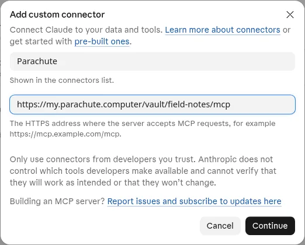
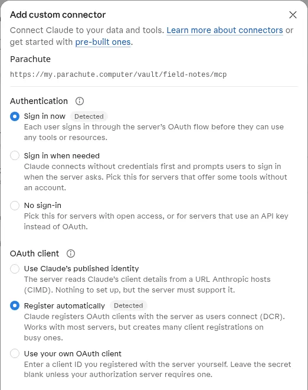

Your AI needs one thing: your vault's address.

- **On Parachute Cloud:** `https://my.parachute.computer/mcp`
- **On your own server:** `https://<your server>/mcp`

When you connect, Parachute's own page asks which vault and what the AI may do. Choose **Read & write**, so it can
save what you tell it; with read only it can look but can't remember anything.

An address for one vault only

- **Parachute Cloud:** each vault's own address, `https://my.parachute.computer/vault/<your vault>/mcp`, is under
  **Connect your AI** on its card. It skips the choice of vault.
- **Your own server:** `https://<your server>/vault/<vault name>/mcp`. The app shows both addresses under
  **Connect**, with **Copy**.

## Claude

**Tested end to end** on claude.ai, 25 November 2026, against a server of ours on Parachute's next release:
connecting, remembering, finding, live pages and skills. (Skills come to Parachute Cloud with that release.)

1. In a chat, press **+**, then **Plugins › Manage plugins**. On **Your plugins**, press **Add**, then **Add custom connector**.
2. Name it `Parachute`, paste your address, and press **Continue**.
3. Claude checks the address and picks **Sign in now** and **Register automatically** for you. Leave them and press **Add**.
4. Parachute's page opens. Sign in (on Cloud, the emailed link or code), keep **Read & write**, and press **Allow**.

Show the screens

*Pictures from claude.ai, connected to a test server. In the second and third the connector's name and address are
changed to Parachute Cloud's; everything else is as claude.ai drew it.*

More: the approval page, asking before each tool, Claude Code

- **The approval page on Parachute Cloud**, through `https://my.parachute.computer/mcp`: **Connect Claude** asks which
  vault, and **Read & write** is chosen already. Leave **Full admin** unchosen. (Through a vault's own address the page
  just says "Claude wants to read and write notes in" that vault: press **Allow**.)
- **On your own server:** choose **Write** for each vault it should save to, and make sure **admin** is unticked.
- **Admin** is for changing how a vault is set up; you can give it later, on purpose ([It needs admin](/docs/fix/needs-admin/)).
- **Asking before each tool:** on claude.ai's **Manual** setting Claude asks before each tool call, reads included;
  **Always allow** on the card is meant to stop that for the tool. On **Auto** (the default now) it goes ahead.
- **Claude's free plan** allows one custom connector (Parachute Cloud's account page notes this).
- **Claude Code:** `claude mcp add --transport http parachute https://my.parachute.computer/mcp`, then `/mcp` in
  Claude Code to sign in.

## ChatGPT

**Early runs pass; we're still testing.** On 12 November 2026 ChatGPT signed in to a server of ours, wrote notes and
read them back. Reading one note by its name failed until a fix that ships in Parachute's next release. We haven't
walked it on Parachute Cloud yet.

1. In ChatGPT, add Parachute by pasting your address. In our run ChatGPT called such a connection a plugin (or an
   app); its menus change, so the names may differ.
2. Sign in on Parachute's page and allow **Read & write**.
3. Set its permission to **Allow read-only tools**. On Parachute's next release ChatGPT then reads without asking and
   still asks before it writes (press **Refresh tools** if it doesn't). On today's release it asks before every read.

More: what we haven't checked

Our runs used a paid ChatGPT account. We haven't tried the free plan, and we didn't write the menu path down step by
step; it may also ask for Developer mode. A plugin has one permission for all its tools (Always ask,
Allow read-only tools, Allow low-risk tools, Allow all tools); each Parachute tool says whether it only reads, which
is what lets ChatGPT skip asking for reads.

## Local models

**Works in our runs.** In November 2026 a model running on our own machine, through an agent app, read and wrote a
test vault with a key. We haven't written steps for each app yet, or tried signing in from one.

1. Use an app that runs your model and speaks MCP, with a model that can call tools.
2. Add an MCP server over HTTP: one vault's own address, with a key
   ([Keys and what they reach](/docs/build/keys-and-scopes/)). This is the way we ran it, with the vault on the same
   machine.
3. Or give it your address above and sign in when the app opens Parachute's page. That should work as it does for
   Claude; we haven't tried it from a local app.

More: keep everything on your machine

Run Parachute on the same computer as the model ([Run your own](/docs/run/self-host/)). The address is then
`http://127.0.0.1:1939/vault/<vault name>/mcp`, with the key as `Authorization: Bearer <key>`. The model and the
vault are then both on your computer.

## Other apps

**The same address; less walked by us.** Claude Code and the Codex CLI run against Parachute in our own tests. Cursor,
Grok, Muse and others take the same thing: an MCP server over HTTP, signed in with OAuth.

## Then ask it

Your AI starts each conversation knowing your vault's name and its types. Try:

- "Remember this in Parachute: …" and, in a new chat, "What did I tell you about …?"
- "Make me a live board of my open tasks that I can tick off." ([Live pages](/docs/use/claude-artifacts/), in Claude)
- "Make me a reading tracker I can use in Parachute."

## What it can do

- **What you allowed, in the vaults you gave it:** read, or read and write (which includes making a type and adding
  fields to a type it made). It never reaches a vault you left out.
- **It connects as itself, not as you.** On your own server the app lists it under Vault, your vault, **Sharing**, and
  **End** there takes it back.
- **To change its level,** remove the connector and add it again.
- **It can't make an applet run:** you allow each one in the app ([What Allow means](/docs/use/allowing-applets/)).

Stuck? [Claude won't connect](/docs/fix/connect/) has the fixes we know.
