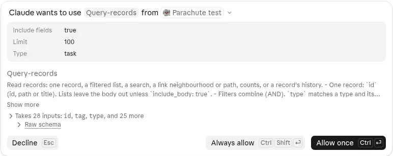

Your AI needs one thing: your vault's address, which ends in `/mcp`.

- **Parachute Cloud:** `https://my.parachute.computer/mcp`, the same for everyone; you pick the vault when you allow
  it. Each vault's own address, `https://my.parachute.computer/vault/<your vault>/mcp`, is under **Connect your AI**
  on its card.
- **Your own server:** `https://<your server>/mcp` reaches every vault you choose when you allow it;
  `https://<your server>/vault/<vault name>/mcp` reaches one. The app shows both under **Connect**, with **Copy**.

## Claude

On [claude.ai](https://claude.ai). (Parachute Cloud's account page notes that Claude's free plan allows one custom
connector.)

**1.** In a chat, press **+**, then **Plugins › Manage plugins**. On **Your plugins**, press **Add**, then **Add custom connector**.

**2.** Name it `Parachute`, paste your address, and press **Continue**.

**3.** Claude checks the address and picks **Sign in now** and **Register automatically** for you. Leave them and press **Add**.

*Pictures from claude.ai, connected to a test server. In these two the connector's name and address are changed to
Parachute Cloud's; everything else is as claude.ai drew it.*

**4.** Parachute's page opens. Sign in (on Cloud, the emailed link or code), then allow Claude at **Read & write**, so
it can save what you tell it. With read only it can look but can't remember anything.

- **Parachute Cloud**, through `https://my.parachute.computer/mcp`: **Connect Claude** asks which vault, and the access
  level, **Read & write**, is chosen already. Leave **Full admin** unchosen. (Through a vault's own address the page
  just says "Claude wants to read and write notes in" that vault: press **Allow**.)
- **Your own server:** choose **Write** for each vault it should save to. Through one vault's own address Claude asks
  for every level and admin comes ticked: untick it.

Admin is for changing how a vault is set up; you can give it later, on purpose ([It needs admin](/docs/fix/needs-admin/)).

**5.** Back in claude.ai the connector shows as connected. Ask something. On claude.ai's **Manual** setting Claude asks
before each tool call, reads included; **Always allow** on the card is meant to stop that for the tool. On **Auto**
(the default now) it goes ahead.

**Claude Code:** `claude mcp add --transport http parachute https://my.parachute.computer/mcp`,
then `/mcp` in Claude Code to sign in.

## ChatGPT

In Settings, **Apps & Connectors**: create a custom connector (an MCP server) and paste the same address. It needs a
paid plan, and may need Developer mode. Each tool says whether it only reads or changes something, so ChatGPT needn't
ask before every read.

## Any other MCP app

Cursor, Grok, Muse and others take the same address: an MCP server over HTTP, signed in with OAuth.

## Then ask it

Your AI starts each conversation knowing your vault's name and its types. Try:

- "Remember this in Parachute: …" and, in a new chat, "What did I tell you about …?"
- "Make me a live board of my open tasks that I can tick off." ([Live pages](/docs/use/claude-artifacts/))
- "Make me a reading tracker I can use in Parachute."

## What it can do

What you allowed, in the vaults you gave it: read, or read and write (which includes making a type and adding fields
to a type it made). It never reaches a vault you left out. It connects as itself, not as you: on your own server the app lists it
under Vault, your vault, **Sharing**, and **End** there takes it back. To change its level, remove the connector and
add it again. An AI can't make an applet run: you allow each one in the app ([What Allow means](/docs/use/allowing-applets/)).

Stuck? [Claude won't connect](/docs/fix/connect/).
