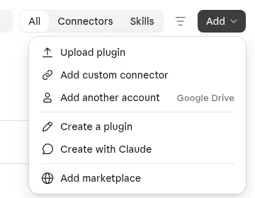

Whatever AI you use, connecting is the same: give it your vault's address.

```
https://my.parachute.computer/mcp
```

That is Parachute Cloud's, the same for every account. On your own server it is `https://<your server>/mcp`.

1. In your AI app, add a connector and paste the address. Apps call this a custom connector, an MCP server or a plugin.
2. Parachute's page opens. Sign in and pick your vault.
3. Keep **Read & write**, so it can save what you tell it, and press **Allow**.

<details id="notes-for-some-apps">
<summary>Notes for some apps</summary>

- **Claude.** In a chat, press **+**, then **Plugins › Manage plugins › Add › Add custom connector**. Name it
  `Parachute`, paste the address, press **Continue**, then **Add**. *Tested end to end on claude.ai, 25 November 2026,
  against a server of ours on Parachute's next release.*
- **ChatGPT.** Add it in ChatGPT's settings; in our run ChatGPT called it a plugin (or an app). Then set its
  permission to **Allow read-only tools**. *Still testing: early runs pass on a server of ours (12 November 2026); not
  yet walked on Parachute Cloud.*
- **Local-model apps.** Use an app that speaks MCP and a model that can call tools. Add an MCP server over HTTP: one
  vault's own address, with a [key](/docs/build/keys-and-scopes/). *Works in our runs (November 2026), this way, with
  the vault on the same machine; signing in from a local app is untried.*
- **Claude Code, Codex, Cursor and others.** The same address: an MCP server over HTTP, signed in with OAuth. In
  Claude Code, `claude mcp add --transport http parachute https://my.parachute.computer/mcp`, then `/mcp` to sign in.
  *Claude Code and the Codex CLI run against Parachute in our own tests; the rest are less walked by us.*

</details>

<details>
<summary>More: the screens in Claude, and the fine print</summary>




*Pictures from claude.ai, connected to a test server. In the second and third the connector's name and address are
changed to Parachute Cloud's; everything else is as claude.ai drew it.*

- **An address for one vault only.** On Parachute Cloud each vault's own address,
  `https://my.parachute.computer/vault/<your vault>/mcp`, is under **Connect your AI** on its card; on your own server
  it is `https://<your server>/vault/<vault name>/mcp`, and the app shows both under **Connect**, with **Copy**. It
  skips the choice of vault.
- **The approval page.** On Parachute Cloud **Read & write** is chosen already; leave **Full admin** unchosen. On your
  own server choose **Write** for each vault it should save to, and make sure **admin** is unticked. Admin is for
  changing how a vault is set up; you can give it later, on purpose ([It needs admin](/docs/fix/needs-admin/)). With
  read only your AI can look but can't remember anything.
- **Claude.** After **Continue**, Claude picks **Sign in now** and **Register automatically** for you: leave them. On
  claude.ai's **Manual** setting Claude asks before each tool call, reads included, and **Always allow** on the card is
  meant to stop that for the tool; on **Auto** (the default now) it goes ahead. Claude's free plan allows one custom
  connector. Our test covered connecting, remembering, finding, live pages and skills; skills come to Parachute Cloud
  with the next release.
- **ChatGPT.** With **Allow read-only tools**, on Parachute's next release ChatGPT reads without asking and still asks
  before it writes (press **Refresh tools** if it doesn't); on today's release it asks before every read, reading one
  note by its name fails, and it may say the vault didn't confirm a save that did go through. Our runs used a paid
  account; we haven't tried the free plan or written the menu path down step by step, and it may ask for Developer
  mode.
- **A local model, with everything on your machine.** Run Parachute on the same computer
  ([Run your own](/docs/run/self-host/)). The address is then `http://127.0.0.1:1939/vault/<vault name>/mcp`, with the
  key as `Authorization: Bearer <key>`.

</details>

## Then ask it

Your AI starts each conversation knowing your vault's name and its types. Try:

- "Remember this in Parachute: …" and, in a new chat, "What did I tell you about …?"
- "Make me a live board of my open tasks that I can tick off." ([Live pages](/docs/use/claude-artifacts/), in Claude)
- "Make me a reading tracker I can use in Parachute."

## What it can do

- **What you allowed, in the vaults you gave it:** read, or read and write (which includes making a type and adding
  fields to a type it made). It never reaches a vault you left out.
- **It connects as itself, not as you.** On your own server the app lists it under Vault, your vault, **Sharing**, and
  **End** there takes it back.
- **To change its level,** remove the connector and add it again.
- **It can't make an applet run:** you allow each one in the app ([What Allow means](/docs/use/allowing-applets/)).

Stuck? [Claude won't connect](/docs/fix/connect/) has the fixes we know.
