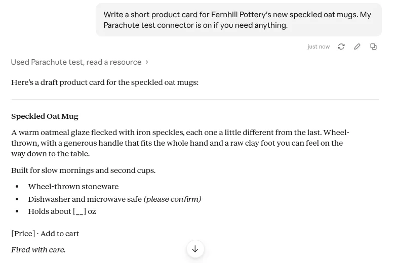

A **skill** is a record of type `skill`. Its body is instructions, its `description` says when to use it, and every AI connected to your vault may read it and follow it: how you write product copy, how you check in with a client, how you file a receipt.

## How your AI finds them

- **Every AI.** Once your vault has a skill it can see, the connection tells your AI so. It lists them with `query-records { type: "skill" }` and reads the one a task matches before it starts.
- **Claude Code**, with Skills over MCP on: it lists them as skills (`<connector name>:<skill>`, e.g. `parachute:shop-copy`) and loads one only when a task matches. Beside yours it gets two from Parachute: `vault-guide` (your vault's types and fields, made fresh from the vault) and `live-page` (how to [build a live page](/docs/use/claude-artifacts/)). Anthropic is rolling this out: on by default for Pro, Max and Ultra; on Team an owner turns it on, and a server you add yourself stays off there unless an admin allows it; Enterprise is coming. `claude -p` gets no skills. Where it isn't on, the way every AI uses (above) works.
- **claude.ai.** When it connects, it lists your vault's skills beside its own. In our runs Claude used one unprompted when a task matched: asked for a product card, it loaded the shop's "Brand Design" skill and wrote in its colours and sign-off; asked "How did my week go?", it followed "Weekly Review" step by step. Duet (claude.ai's agent) finds them as records instead.



## Make one

Your AI needs admin on that vault: connect it through the vault's own address and give it admin there. At Write it is refused. Then ask it to write the skill, or write it yourself:

```
create-record {
  path: "Skills/Shop copy",
  types: ["skill"],
  fields: { description: "How to write product copy for the shop. Use when writing a listing or a caption." },
  body: "# Shop copy\n\nShort sentences. Say what it's made of and who made it. Read [the voice notes](voice.md)."
}
```

- Its name is the last part of its path as a slug (`shop-copy`), or a `name` field.
- Its files are skill records under its path: `Skills/Shop copy/voice` is `voice.md`. Only skill records count, so nobody can slip a file in beside it. A file without the `skill` type is left out without a warning, and Claude says it "wouldn't open": give each file the type.
- A body that starts with `---` frontmatter is taken whole as a `SKILL.md`, so you can paste one from elsewhere.
- A skill without a `description` isn't listed.

## Who may add or change one

Only an admin key, or a pack you install. A skill is instructions every connected AI may follow, so a skill planted by anyone who can write would keep steering your AI. Any other key is refused with `skill_needs_admin`, which says why. That covers making a skill, changing its words or fields, taking the type off, defining the `skill` type itself, and records of a type an admin made under `skill` (`query-records` lists its subtypes with it). An admin key limited to some tags counts as a write key here: a skill reaches every AI on the vault. A rename by a non-admin key never rewrites a skill that links to the renamed record, and a recording attached to a skill never has its transcript written into it.

Reading and following skills needs no admin. Deleting one is like deleting any record: history keeps it.

The generated `vault-guide` shows your types and fields only by name. Anyone who can write may add a type, so it never repeats a type's description as instructions.

## Limits

- **Your own server** has skills and the admin rule once you update to the Parachute release that carries them. **Parachute Cloud doesn't have skills yet:** it lists none, and doesn't yet keep skill writes to admin.
- **claude.ai reads the list once, when it connects.** A skill added or changed after that isn't seen as a skill in that session (in our runs, Claude noticed the change and read the record instead). Ask it to read the skill by name. Removing the connector and adding it again should refresh the list (not tried yet).
- **Claude Code asks you to allow each version** of a skill (when it isn't in auto mode). A changed skill asks again.
